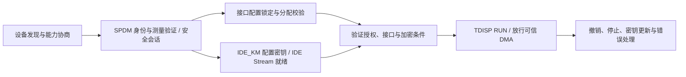

# Vera Rubin NVL72：安全专题与信任边界

核验日期：2026-10-10。本文使用用户本地文档 C，并以 NVIDIA、Arm、DMTF、PCI-SIG 的原始资料交叉核验。`research/security-sources.json` 提供可供前端引用的 SEC 编号。**“已确认”表示公开资料支持该项声明，不表示本项目验证了硬件实现、已开启相应功能或完成性能实测。** 前端中的证明、隔离与流量动画是教学模拟。

## 1. 本地文档 C 与证据边界

已读取 [NVIDIA_Sentry_架构与安全洞察报告.pdf](/Users/xiangyixu/Downloads/集群/NVIDIA_Sentry_架构与安全洞察报告.pdf) 全部 19 页，未以对话摘要替代实际读取。文档标注资料截至 2026-10-09。

| 本地定位 | 本项目采用内容 | 处理方式 |
|---|---|---|
| p.1-3 | 2026-09-28 发布身份；Sentry 与 NVSentinel 区别；OpenShell 与独立硬件域 | 用 SEC06、SEC08、SEC21 核验 |
| p.5，图 1 | 业务数据、控制、证据三类流动 | 采用职责分析，不称作官方物理布线 |
| p.9-10 | DMA 可见性、加密与观察的边界 | 不推断 Argus 可读 Realm 私有内存 |
| p.11 | 毫秒级隔离的测量边界 | 保留为验收建议，不写成固定 SLA |
| p.12、16 | NVLink、IMEX、Astra 与 Sentry 分工 | 保留 Vera Rubin 相关结论；不迁移其他平台 BOM 或支持状态 |
| p.18-19 | 官方原始资料清单 | 独立打开来源核验；动态文档以本次可见版本为准 |

文档 C p.19 把 Scale-In 技术文章记为“2026 年 9 月”；本次官方页面显示 **2026-08-24**，应采用官方页面日期。参见 [SEC03：Scale-In 技术文章](https://developer.nvidia.com/blog/nvidia-bluefield-4-powers-new-scale-in-network-infrastructure-for-agentic-ai-factories/)。

## 2. Astra：把基础设施管理权移出租户主机

Astra 全名为 Advanced Secure Trusted Resource Architecture，是以 BlueField-4 为中心的系统架构。DPU 通过到 ConnectX-9 的专用连接实施配置、监控和策略管理。策略由 DPU 带外入口进入，在 SuperNIC 硬件执行；租户可使用 NIC 数据面，不能据此取得管理面控制。HBN、加速 OVS、Argus、SNAP 与 DMS 分别承担网络、安全、存储和生命周期职责。参见 [SEC01：Astra，What is NVIDIA BlueField Astra? / Figure 1 / Extending operational workflows](https://developer.nvidia.com/blog/redefining-secure-ai-infrastructure-with-nvidia-bluefield-astra-for-nvidia-vera-rubin-nvl72/)。

NVIDIA Infra Controller 文档明确：Astra 配置的 ConnectX-9 与 BlueField-4 配对后，SuperNIC 按设计锁定，只由 DPU 管理。该页后面的其他硬件锁定密钥流程并不等于 Astra 协议。参见 [SEC02：SuperNIC Lockdown Key Management，Background](https://docs.nvidia.com/infra-controller/documentation/architecture/super-nic-lockdown-key-management)。

**工程解释：**控制数据包转发策略与亲自转发所有张量不是同一件事。前端绿色 Astra 连线表示控制权关联；蓝色计算网络可由 GPU/主机经 ConnectX-9 接入机架外 fabric，不能让动画把所有东西向数据绕入 DPU 的南北向端口。

Scale-In 的官方范围是 AI 工厂的南北向接入、基础设施安全、存储和数据流动，包含机柜外服务。把它仅定义为“机柜内部存储与管理网络”过窄。参见 [SEC03：Scale-In accelerates north-south AI factory infrastructure](https://developer.nvidia.com/blog/nvidia-bluefield-4-powers-new-scale-in-network-infrastructure-for-agentic-ai-factories/)。

**待核实：**专用控制链路的承载协议、密码套件、握手、密钥持有者、重放保护及轮换周期，在本次已读 Astra 资料中没有完整公开；图上不标注自行推断的 TLS、SPDM 或 IDE。Astra 管理隔离也不自动完成 Realm 的证明与租户密钥释放。

## 3. DOCA Argus 与 NVIDIA Sentry

### 3.1 Argus：独立观察运行状态

DOCA 3.5.0 指南说明 Argus 在 BlueField 的独立信任域运行，通过 DOCA DMA 读取选定的易失主机内存结构，并按内核对应内存映射解析进程、线程、执行状态及二进制/库 SHA-256 等信息。它无需主机常驻代理；当前指南支持 Linux x86 和 Arm64、要求受支持 DPU 模式及相应权限，KVM 是列出的已测试虚拟化范围。参见 [SEC04：Argus Guide，Introduction / Operation / Requirements / Limitations](https://networking-docs.nvidia.com/doca/archive/3-5-0/doca-argus-service-guide)。

指南描述策略引擎生成事件和告警，外部安全平台可进行关联分析。因此 UI 可显示“运行时观察服务”，不能编造真实 Argus 心跳、租户安全评分或实际攻击检测结果。与预期运行清单比较摘要是完整性分析方式，摘要相同本身不证明程序行为安全。所谓“DPU 侧本地 AI/ML 后再送 XDR/SIEM”应视具体部署方案，不能断言它是每个 Argus 安装的必经流程。

官方 Argus 介绍给出“最高 1,000 倍”检测速度声明；本项目没有其完整测试方法或实测数据，因此保留“厂商上限声明、依赖测试条件”，不换算成固定毫秒数。参见 [SEC05：NVIDIA Brings Cybersecurity to Every AI Factory](https://blogs.nvidia.com/blog/cybersecurity-ai-factory-doca-argus/)。

**机密计算边界：**公开指南的 DMA 能力不能证明 Argus 能读取 Realm 私有明文、GPU HBM 明文或所有加密会话。未授权设备访问 Realm 内存应受硬件隔离约束。两者组合需明确观察的是共享页、可披露遥测，还是被合法分配且通过证明的可信设备；本次资料未给出 Vera Rubin 上 Argus 与 Realm 的完整支持矩阵。前端对此标“待核实”。

### 3.2 Sentry：基于官方资料与固定源码的深入研究

研究日期：2026-10-10。优先核对用户指定的[Agent Safety产品页](https://www.nvidia.com/en-us/solutions/ai/agent-safety/)与[OpenShell仓库](https://github.com/NVIDIA/OpenShell)。软件基线固定为**v0.1.3**、提交`e1f3c82caa3ed3b65de22889ae7ef32a774878ef`（2026-10-09）；另记录main快照`eeba0e7954c0fb4d8e9e2e29d1bfa68e290eb8b3`（2026-10-10），不把开发快照视为稳定版承诺。只读分析，没有运行OpenShell、Sentry或真实DPU。

#### 定位与证据等级

Sentry是Open Agent Safety Platform中的BlueField-4/DOCA带外watchdog参考系统设计；OpenShell是已有公开实现的运行时。官方发布稿描述持续监测、身份治理、细粒度策略与毫秒级隔离。**平台声明、公开软件实现、真实部署验收是三个证据层次。**“open platform”不能推导为所有Sentry硬件固件、检测器、SDK和证明报文均已开源。[SEC06](https://nvidianews.nvidia.com/news/open-agent-safety-platform)、[SEC08](https://www.nvidia.com/en-us/solutions/ai/agent-safety/)。

在v0.1.3的README、docs、crates、rfc范围内检索Sentry/BlueField/DOCA，未定位NVIDIA Sentry的DPU实现和完整公开接口。唯一同名sentry命中为[gVisor注释](https://github.com/NVIDIA/OpenShell/blob/e1f3c82caa3ed3b65de22889ae7ef32a774878ef/crates/openshell-sandbox/src/sandbox/linux/landlock.rs#L261)。这只是有范围的检索结论，不证明不存在其他交付物。它也不等于[NVSentinel](https://docs.nvidia.com/nvsentinel/v1.25.0/getting-started/overview/)。检索元数据保存在`research/sentry-investigation.json`。

#### 双域架构与三类流动

OpenShell的Gateway管理身份、策略、provider和生命周期。Sandbox与agent同处工作负载边界内，拥有进程、识别程序并转送请求；可信Supervisor在另一侧作决定、提供凭证并连接上游。运行时负责建立外层出口约束。Docker/Podman的Supervisor为独立容器，经认证Unix socket通信，工作负载直接网络关闭；Kubernetes使用独立Pod、mTLS与实际执行NetworkPolicy的CNI；VM使用宿主Supervisor与vsock、guest无直接网卡。[SEC24：Architecture](https://github.com/NVIDIA/OpenShell/blob/e1f3c82caa3ed3b65de22889ae7ef32a774878ef/docs/about/architecture.mdx)、[SEC30：Docker隔离源码](https://github.com/NVIDIA/OpenShell/blob/e1f3c82caa3ed3b65de22889ae7ef32a774878ef/crates/openshell-driver-docker/src/isolation.rs)。

业务请求、策略/身份控制、证据/审计应分别绘图。“进程外”不等于“主机外”：单独的Supervisor容器仍需要可信的宿主和运行时；Sentry参考设计增加独立BlueField硬件域。DOCA与OpenShell策略如何映射、版本同步和原子更新，尚无完整接口证据，不能在图上编造固定RPC、端口或TLS握手。[SEC07](https://developer.nvidia.com/blog/nvidia-open-agent-safety-platform-a-reference-for-continuous-in-silicon-agent-monitoring/)。

当前Architecture及Docker源码明确network_mode=none，而同版安全最佳实践还含veth/“gateway level”代理概括。图示按固定版本和具体runtime绘制，不把这几种表述合成所有部署的通用物理路径。文档与源码仍应随版本继续核验。[SEC33](https://github.com/NVIDIA/OpenShell/blob/e1f3c82caa3ed3b65de22889ae7ef32a774878ef/docs/security/best-practices.mdx)。

#### 请求检查与凭证的两道授权

OpenShell先按host、port和实际调用binary检查连接。设置受检查协议后，还可限制REST方法/路径、MCP工具等。**L7的audit是记录违规并继续转发，enforce才阻断相应规则违规。**audit不关闭连接授权，也不会把凭证目标不匹配变成允许。未配置protocol不等于API只读；允许主机也不等于允许所有凭证进入该主机。[SEC26](https://github.com/NVIDIA/OpenShell/blob/e1f3c82caa3ed3b65de22889ae7ef32a774878ef/docs/how-it-works/policies/network-rules.mdx)。

被OpenShell托管的API秘密以占位符交给agent，可信代理在转发前替换；网络策略与凭证host/port/path绑定都必须满足。无效或不匹配时失败关闭。该保证不覆盖用户自行写入工作区或普通环境变量的秘密。TLS终止才能提供相应L7检查与占位符替换；tls:skip/不透明隧道无相同内容可见性。这些是OpenShell软件事实，不能擅自转写成Sentry解密实现。[SEC27](https://github.com/NVIDIA/OpenShell/blob/e1f3c82caa3ed3b65de22889ae7ef32a774878ef/docs/how-it-works/providers/overview.mdx)、[SEC33](https://github.com/NVIDIA/OpenShell/blob/e1f3c82caa3ed3b65de22889ae7ef32a774878ef/docs/security/best-practices.mdx)。

网站新增教学请求实验：允许读取、越权写入、未授权目的地、凭证绑定不匹配。切换audit/enforce可看到结果区别。它只计算示例规则，没有调用策略引擎、SMT、DPU或真实上游服务。

#### 形式化验证的实际边界

OpenShell的SMT prover提供两个不同检查：boundary check检查候选允许集合是否超出给定边界；proposal risk check检查新增网络规则相对现有策略增加的风险。前者通过不能替代后者，反之亦然。边界自身由运营者定义，错误或过宽的边界不会自动变成正确的业务意图。[SEC25](https://github.com/NVIDIA/OpenShell/blob/e1f3c82caa3ed3b65de22889ae7ef32a774878ef/docs/how-it-works/policies/prover.mdx)、[SEC29](https://github.com/NVIDIA/OpenShell/blob/e1f3c82caa3ed3b65de22889ae7ef32a774878ef/docs/how-it-works/policies/advisor.mdx)。

`within_boundary`仅表示在已建模语义内成立。`exceeds_boundary`给出反例；`unsupported`、`inconclusive`、`error`均不能当成通过。v0.1.3覆盖部分文件、进程、Landlock、L4 TCP与REST语义；运行时能够检查GraphQL/MCP不代表边界证明器已覆盖它们。通过证明不保证“策略已经最小”“任务安全”“真实运行时已执行此策略”。镜像、全局配置和provider可改变有效策略，必须读取实际policy及运行时附加权限。[SEC25](https://github.com/NVIDIA/OpenShell/blob/e1f3c82caa3ed3b65de22889ae7ef32a774878ef/docs/how-it-works/policies/prover.mdx)、[SEC34](https://github.com/NVIDIA/OpenShell/blob/e1f3c82caa3ed3b65de22889ae7ef32a774878ef/docs/how-it-works/policies/default-policy.mdx)。

#### 身份与attested telemetry不能混为普通日志

OpenShell的Gateway JWT和Sandbox JWT按sandbox与generation绑定，生命周期和使用通道分开；它们是软件会话身份，不是已经公开的Sentry设备证明格式。[SEC24](https://github.com/NVIDIA/OpenShell/blob/e1f3c82caa3ed3b65de22889ae7ef32a774878ef/docs/about/architecture.mdx)。

官方对Sentry提出attested telemetry及身份/委派治理能力。本次材料仍未定位其签名主体、证书链、nonce/序号、策略绑定、设备测量与远程验证完整流程。[SEC06](https://nvidianews.nvidia.com/news/open-agent-safety-platform)。

OpenShell OCSF导出是**best-effort**，不是完整历史保证；队列满可能丢弃新行，日志保留依赖外部采集。metadata.uid用于事件身份，container.uid关联sandbox。JSON结构、可检索日志、密码签名、设备远程证明和完整性保证，应分别验收。不能把OCSF日志存在当成Sentry的证明链已经成立。[SEC28](https://github.com/NVIDIA/OpenShell/blob/e1f3c82caa3ed3b65de22889ae7ef32a774878ef/docs/observability/ocsf-json-export.mdx)。

#### 必要模型路径与机密计算的张力

官方指定Vera Rubin POD拓扑把每个计算托盘的BlueField-4放在节点通往模型的必要路径。这里“带外”描述控制权隔离，“必要路径”描述数据路径覆盖，两者不冲突。[SEC07](https://developer.nvidia.com/blog/nvidia-open-agent-safety-platform-a-reference-for-continuous-in-silicon-agent-monitoring/)。

**工程洞察：**阻止下一次模型调用，不自动撤销已经提交的工具操作、后台任务和数据库写入；本地模型、备用出口、离线凭证和长连接需要单独验证。Sentry对推理API的治理，不能外推成对NVLink/NCCL全部张量的理解。Realm、GPU TEE和链路加密保护的租户秘密，也不能默认向监控域开放；需设计最小披露、授权解密或受证明的可信检测路径。这些是待落地的集成问题，不是厂商已公布的默认部署。

Astra管理SuperNIC控制权，Argus观察可见运行状态，Sentry治理agent活动，Realm保护执行域，IMEX管理显存映射授权。公开证据没有建立Sentry必须依赖Astra、以Argus DMA为唯一传感器或替代IMEX的关系。

#### 毫秒级隔离如何验收

建议定义t0异常动作、t1产生证据、t2判定完成、t3执行点确认、t4副作用停止。分别报告t2−t0检测延迟、t3−t2执行延迟、t4−t0业务止损延迟，以及并发、消息尺寸、P50/P95/P99、超时、误报和恢复权限。这是工程验收建议；本次官方材料未给出可复现基准，因此不承诺固定SLA。

[OpenShell freeze源码](https://github.com/NVIDIA/OpenShell/blob/e1f3c82caa3ed3b65de22889ae7ef32a774878ef/crates/openshell-sandbox/src/boundary_io.rs)可见SIGSTOP等软件机制，但不能由此推断Sentry的硬件隔离命令。DPU失联、固件更新、策略漂移、设备复位和证据采集故障仍须有完整运行规程。

### 3.3 与 SPDM、TDISP、IDE、Caliptra 的关系

这些机制位于不同层：设备身份与会话、设备接口分配、PCIe 数据保护、硬件信任根分别回答不同问题，不自动构成“Argus 依次验证完这些协议”的产品流水线。Caliptra 是硬件信任根 IP 项目；本次 NVIDIA 一手资料未确认 Vera Rubin 每种芯片所用 Caliptra 版本、固件测量路径或 Sentry 与之绑定的方法。参见 [SEC22：Caliptra RTL](https://github.com/chipsalliance/caliptra-rtl)，**平台具体绑定待核实**。

## 4. Realm VM：保护工作负载执行环境

### 4.1 定义与区别

Vera 官方说明确认 Arm CCA/RME、每 VM 加密密钥、安全分配 TDISP 设备及 authenticated C2C encryption。参见 [SEC10：Vera CPU，Confidential Compute](https://developer.nvidia.com/blog/?p=120182)。Arm 的 Realm 隔离由 RME、安全状态、RMM/Root 软件及 GPC/GPT 内存访问检查共同构成。参见 [SEC12：Arm CCA Hardware Architecture](https://support.arm.com/documentation/den0125/latest/Arm-CCA-Hardware-Architecture?lang=en)。

| 名称 | 可成立的安全含义 | 本项目的解释边界 |
|---|---|---|
| 普通 VM | 通过虚拟化隔离工作负载 | 一般仍信任管理它的宿主与 hypervisor |
| “安全 VM” | 不是可单独验收的固定协议名 | 必须列出具体隔离、启动、密钥与证明能力 |
| 机密 VM / CVM | 使用硬件 TEE 限制宿主访问执行中数据 | 具体威胁模型、I/O 和证明支持依平台而异 |
| Realm VM | Arm CCA Realm 中执行的 VM | 宿主可管理资源，但受保护内容访问由 CCA 机制限制 |

**不应扩写：**每 VM 有密钥，不等于已公开“Vera CPU 某安全状态机在 Realm 创建瞬间生成、特定接口绑定、结束立即销毁”的全部实现。本项目将密钥生成者、存储位置、轮换、迁移、销毁证据保留为待核实；不借用其他 CPU 的实现填空。

### 4.2 CPU、GPU、DPU 与互联的角色

NVIDIA 为 Vera Rubin NVL72 描述了跨 CPU、GPU 和互联的机架级 TEE，列出受保护 C2C、GPU 间 NVLink 加密及 PCIe IDE/TDISP。参见 [SEC11：Inside the NVIDIA Vera Rubin Platform，Third-generation confidential computing / Figure 29](https://developer.nvidia.com/blog/inside-the-nvidia-rubin-platform-six-new-chips-one-ai-supercomputer/)。

教学上可把 CPU Realm 画为租户执行域，把 GPU 画为需要独立身份、状态及设备授权的计算端点，把 DPU/Astra 画为基础设施控制域。**不能把 DPU 的独立管理权等同于取得所有 Realm 密钥。** 同理，NVLink 加密的公开声明不回答交换机是否纯转发密文、是否参与逐跳密钥、密钥由哪些端点生成、组成员如何重协商。本项目显示这些为“未披露”，不画出假定的明文交换节点。

### 4.3 可验证环境的交付流程

以下是本项目的验收模型，而非声称 NVIDIA 已发布完全相同的产品协议：

1. 固定 CPU/RMM、GPU、DPU、固件、驱动与工作负载版本及基线。
2. 验证 CPU/guest 与 GPU 等设备证据的身份、签名、时效、nonce、生产安全状态和参考测量。
3. 将设备分配与工作负载/租户身份绑定，校验组成员、授权与资源边界。
4. 验证设备接口状态和受保护 I/O 已就绪后，再向符合政策的工作负载释放秘密。
5. 处理成员退出、证明失败、设备复位、固件变化、撤销与恢复，避免仅在启动时验证一次。

Astra 负责基础设施管理隔离；Sentry/Argus 负责治理与观察；Realm 保护执行环境。任一层的“成功”不能替代其他层的证据。

## 5. SPDM、TDISP 与 PCIe IDE：安全 I/O 的分工

SPDM 用于设备认证、测量相关证明和密钥交换，可由不同传输绑定承载；它不等于全部 PCIe 数据已经加密。参见 [SEC17：DMTF SPDM](https://www.dmtf.org/standards/spdm)。PCIe IDE 保护 TLP 的机密性、完整性与重放安全，TDISP 管理 TEE 设备接口安全。参见 [SEC18：PCI-SIG IDE and TDISP Overview](https://pcisig.com/blog/ide-and-tdisp-overview-pcie%C2%AE-technology-security-features)。

本项目采用以下概念流程：

图示强调**在机密 DMA 放行前，接口授权与 IDE 保护都要满足条件**；步骤细节、请求者和锁定/报告顺序以具体标准版本和平台实现为准。Arm 官方通用一致性测试也包含先建立 IDE Stream、再转入 TDISP RUN 的场景。参见 [SEC20：Arm RME System Architecture Compliance Suite](https://github.com/ARM-software/rme-sysarch-acs/blob/main/Docs/Arm_RME_System_Architecture_Compliance_Suite_Scenario_Document.rst)。不能将“先进入可 DMA 的安全运行态，再补加密”作为安全部署流程。

链路加密保护有端点边界：授权接收方需要使用解密后的数据，因此 PCIe IDE 不自动保护设备内部缓冲区、终止点之后的软件或外部持久存储。驱动、固件、设备分配及最小权限仍需单独验证。存储检查点也需要传输保护和独立落盘加密策略；这里给出的是系统设计要求，不是声称某个默认 NVL72 部署已经启用。

## 6. IMEX：显存映射授权与生命周期

IMEX 协调多个 OS 域间的 GPU 显存导入/导出，与 GPU 驱动交互并管理共享映射的生命周期。守护进程之间使用计算节点网络上的 TCP/IP 和 gRPC；显存读写数据走 NVLink，不是把模型张量装进 IMEX gRPC。参见 [SEC13：IMEX Overview，Multi-Node Memory Sharing Model](https://docs.nvidia.com/deploy/imex-service/overview.html)。

| 对象 | 职责 | 不应推断 |
|---|---|---|
| domain | 参与显存交换的节点/OS 域集合 | 不等于全机架 TEE 的证明组 |
| channel | GPU 驱动执行的共享显存访问授权上下文，以设备节点暴露 | 不是一个独立的物理 NVLink 或用户数据加密密钥 |
| nvidia-imex | 协调导入/导出与映射生命周期 | 不是 GPU 张量数据转发器 |
| nvidia-imex-ctl | 查询和管理服务状态 | 查询正常不证明租户权限已正确隔离 |
| 调度器 / DRA | 需要正确分配节点与 channel 权限 | 此处为集成职责，不宣称 Vera Rubin 某发行版默认组合 |

IMEX 配置页列出 `IMEX_ENABLE_AUTH_ENCRYPTION=0` 为默认值，表示认证与加密关闭。启用后可用 `SSL_TLS`（分别配置服务器/客户端密钥、证书及CA），或基于GSSAPI/Kerberos的 `GSS_AUTH_ENCRYPT`；`GSS_AUTH_ONLY` 仅认证和完整性，不提供加密。服务器/客户端凭证及授权主体仍须正确配置。参见 [SEC14：IMEX Service Secure Connections Configuration](https://docs.nvidia.com/multi-node-nvlink-systems/imex-guide/config.html)。

驱动选择用户可访问的最低编号 channel。如果两用户都能访问 `channel0`，额外给它们 `channel1` 和 `channel2` 仍不能达到预期隔离；应收紧 `channel0` 权限，并保持各节点 channel 分配一致。参见 [SEC15：IMEX Channels，Multi-user channel usage](https://docs.nvidia.com/multi-node-nvlink-systems/imex-guide/imexchannels.html)。

NCCL 的 MNNVL 功能从 2.21 起提供，要求受支持系统/驱动、cuMem 支持和完整可用的 IMEX domain。参见 [SEC16：NCCL_MNNVL_ENABLE](https://docs.nvidia.com/deeplearning/nccl/archives/nccl_2303/user-guide/docs/env.html)。

**Vera Rubin 限定：**上述是已发布 IMEX/NCCL 通用机制；本次公开资料不足以确认 Vera Rubin NVL72 出厂版本、默认启用方式、具体 domain/channel 拓扑及机密计算协同。因此本项目把 IMEX 展示为相关机制并标“Vera Rubin 部署绑定待核实”，不从其他平台文档迁移结论。

## 7. 信任链与前端表达规则

应将“信任链”展示为若干需要分别核验、再由租户策略组合的证明关系：硬件身份与启动固件、CPU/RMM 与 Realm、GPU 身份和安全状态、DPU/基础设施政策、设备接口与安全 I/O、工作负载授权与密钥释放。**BMC → HMC → DPU 是管理关联示意，不是已证实的串行密码学证明链。** Argus/Sentry 也不是 CPU Realm 成立的通用先决条件。

前端每个安全对象应同时显示：所保护的资产、谁控制它、谁能见明文、公开证据范围、仍需验证项。绿灯只能表示用户选择的教学状态；没有实时接口和真实证据时，不显示“设备已证明”“威胁已清除”等实测结论。

| 待核实项 | 可直接显示的文案 |
|---|---|
| Astra 专用控制协议、密钥与握手 | 专用控制连接已确认；密码协议未披露 |
| NVLink 加密端点与交换机角色 | GPU 间加密已确认；端到端/逐跳及交换机密钥角色未披露 |
| Realm 密钥全生命周期 | 每 VM 密钥已确认；生成、轮换、迁移与销毁实现待核实 |
| Argus 与 Realm 共存 | 不推断 Argus 可读 Realm 私有内存；支持矩阵待核实 |
| Sentry 实际交付与不可绕过性 | 参考系统设计；具体版本与路径覆盖需验证 |
| Caliptra 平台绑定 | 信任根具体 IP/版本及证明绑定待核实 |
| IMEX 在本平台的产品绑定 | 通用机制已知；Vera Rubin 默认部署待核实 |
| BMC/HMC/DPU 证明次序 | 管理关联示意；不是已验证的密码证明链 |

本项目的安全动画只用于解释这些边界，不进行真实 DMA、证明请求、密钥生成、设备配置或隔离操作。
